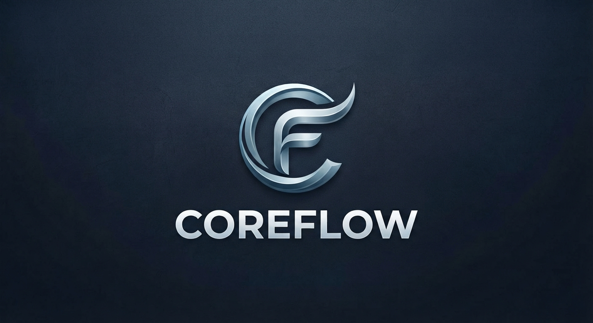
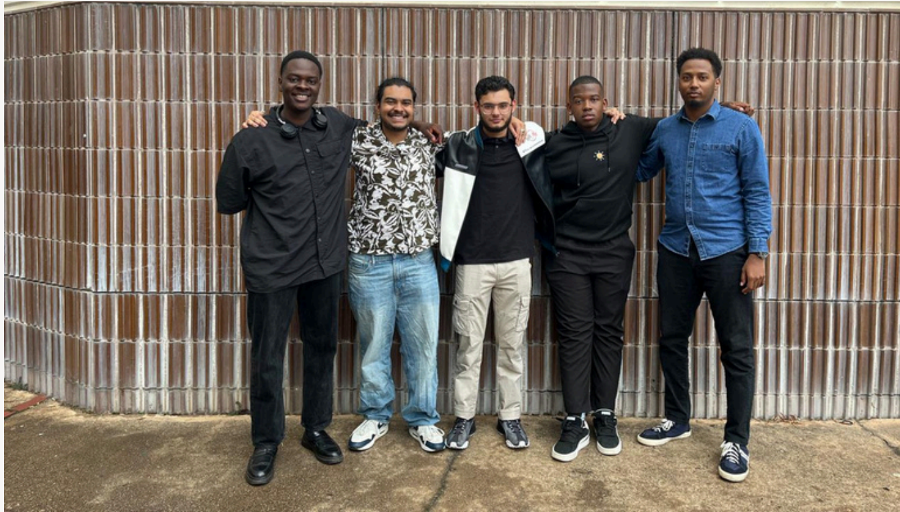

<div align="center">


# [](https://git.io/typing-svg)

---

<p align="center" style="display: flex; align-items: center; justify-content: center;">
  
  <span>Built by <b><a href="https://github.com/OptiGrid">Coreflow</a></b></span>
</p>

---

<p align="center">
  <a href="https://github.com/COS301-SE-2026/OptiGrid/actions"></a>
  <a href="https://codecov.io/gh/COS301-SE-2026/OptiGrid"></a>
  <a href="https://github.com/COS301-SE-2026/OptiGrid"></a>
  <a href="https://github.com/COS301-SE-2026/OptiGrid/issues"></a>
  <br>
  <a href="https://uptimerobot.com"></a>
  <a href="https://github.com/COS301-SE-2026/OptiGrid/commits/develop"></a>
  <a href="https://github.com/COS301-SE-2026/OptiGrid"></a>
  <a href="LICENSE"></a>
</p>

---

*In partnership with **EPI-USE***

<br><br>

<a href="https://github.com/orgs/COS301-SE-2026/projects/52"></a>

</div>

<br>

<div align="center">
  
</div>

## $\color{#4D869C}{\textsf{Project }}\color{#7AB2B2}{\textsf{Overview}}$

**OptiGrid** (built by **Coreflow**) is an enterprise software platform designed for intelligent building energy optimisation and predictive analytics, utilising smart grid technology to help buildings reduce energy waste and optimise consumption in real time. The system connects building managers and energy grids through a high-throughput data pipeline that facilitates telemetry ingestion, communicates ML-driven forecasts, manages hardware configurations, and provides real-time monitoring—all without fundamentally changing the existing building's physical infrastructure.

<br>

<div align="center">

### $\color{#4D869C}{\textsf{Project Website }}\color{#7AB2B2}{\textsf{Link}}$
 **[Visit Live Platform (optigrid.co.za)](https://www.optigrid.co.za)**

</div>

<div align="center">
  
</div>

## $\color{#4D869C}{\textsf{Documentation}}$ & $\color{#7AB2B2}{\textsf{Deliverables}}$

### $\color{#4D869C}{\textsf{Project }}\color{#7AB2B2}{\textsf{Deliverables}}$

| Document | Description | Link |
|---|---|---|
| **Functional Requirements (SRS)** | Complete Software Requirements Specification | [View SRS](docs/SRS.md) |
| **Software Architecture (SAS)** | Architecture Specification, Service Contracts & Traceability Matrix | [View SAS](docs/SAS.pdf) |
| **User Manual** | End-user guide for building managers and system administrators | [View User Manual](docs/User_Manual.pdf) |
| **Coding Standards** | Repository conventions, linting rules, and PR review guidelines | [View Coding Standards](docs/Coding_Standards.pdf) |
| **Brand Style Guide** | UI/UX design system, colour palette, and typography specifications | [View Brand Style Guide](docs/Brand_Style_Guide.pdf) |

<br>

<details>
<summary><h3>View Previous Documentation</h3></summary>
<br>

<details>
<summary><b>Demo 4</b></summary>
<br>

- **NFR Testing (with evidence):** [Traceability Matrix and NFR Tests (SAS)](docs/SAS.pdf)

</details>

<details>
<summary><b>Demo 3</b></summary>
<br>

- **SRS Document:** [Functional Requirements (SRS)](docs/SRS.md)
- **SAS Document:** [Traceability Matrix and NFR (SAS)](docs/SAS.pdf)
- **Service Contracts:** [Service Contracts(SAS)](docs/SAS.pdf)
- **Coding Standards:** [Coding Standards Document](docs/Coding_Standards.pdf)
- **User Manual:** [User Manual](docs/User_Manual.pdf)
- **Testing Policy:** [Testing Policy Document](docs/Testing_Policy.pdf)
- **Brand Style Guide:** [Brand Style Guide](docs/Brand_Style_Guide.pdf)

</details>

<details>
<summary><b>Demo 2</b></summary>
<br>

- **SRS Document:** [Functional Requirements (SRS)](docs/SRS.md)
- **SAS Document:** [Functional Requirements (SAS)](docs/SAS.pdf)
- **Coding Standards:** [Coding Standards Document](docs/Coding_Standards.pdf)
- **User Manual:** [User Manual](docs/User_Manual.pdf)
- **Testing Policy:** [Testing Policy Document](docs/Testing_Policy.pdf)
- **Brand Style Guide:** [Brand Style Guide](docs/Brand_Style_Guide.pdf)

</details>

<details>
<summary><b>Demo 1</b></summary>
<br>

- **SRS Document:** [Functional Requirements (SRS)](docs/SRS.md)
- **Design Specification:** [Design Specification and Brand Style Guide](docs/Brand_Style_Guide.pdf)

</details>

</details>

<div align="center">
  
</div>

## $\color{#4D869C}{\textsf{Team: }}\color{#7AB2B2}{\textsf{Coreflow}}$

<div align="center">
  
</div>

| Avatar | Member & Role | Contact Links | About Me |
|:---:|---|---|---|
|  | **Hamdaan Mirza**<br><sub>*Team Lead, Backend & DevOps Engineer*</sub><br><code>u24631494</code> | [GitHub](https://github.com/Hamdaan-Mirza)<br>[LinkedIn](https://www.linkedin.com/in/hamdaan-mirza/)<br>[Email](mailto:u24631494@tuks.co.za) | **Final Year BSc Information and Knowledge Systems student at the University of Pretoria.** Passionate about problem-solving, software solutions, and learning new technologies across full-stack systems and machine learning. Eager to gain industry experience, expand my perspective on real-world software engineering, and build resilient distributed architectures. Led system integration, REST API design, and database architecture for OptiGrid. |
|  | **Abdelrahman Ahmed**<br><sub>*UI/UX & Frontend Engineer*</sub><br><code>u24898008</code> | [GitHub](https://github.com/abdlrhmanhabish)<br>[LinkedIn](https://www.linkedin.com/in/abdelrahman-esam-9055413b4)<br>[Email](mailto:u24898008@tuks.co.za) | **BSc Computer Science.** Specialises in reactive frontend architectures and data-intensive web applications. Believes complex telemetry should feel effortless and intuitive to the end user. Engineered OptiGrid's responsive Next.js dashboards and real-time visualisation views. |
|  | **Abhay Rooplall**<br><sub>*Data & ML Engineer*</sub><br><code>u24568792</code> | [GitHub](https://github.com/AbhayR1)<br>[LinkedIn](https://www.linkedin.com/in/abhay-rooplall/)<br>[Email](mailto:u24568792@tuks.co.za) | **BSc Computer Science.** Focused on machine learning, time-series forecasting, and scalable data engineering. Driven by turning noisy sensor streams into actionable predictive insights. Architected OptiGrid's telemetry ingestion pipeline and Prophet/Optuna forecasting models. |
|  | **Talifhani Seaba**<br><sub>*UI/UX & Frontend Engineer*</sub><br><code>u23657350</code> | [GitHub](https://github.com/TalifhaniSeaba)<br>[LinkedIn](https://www.linkedin.com/in/talifhani-seaba-2172bb32b/)<br>[Email](mailto:u23657350@tuks.co.za) | **BSc Computer Science.** Passionate about human-centred design, component libraries, and accessible web interfaces. Committed to bridging the gap between engineering performance and visual polish. Crafted OptiGrid's design system, interactive components, and Storybook suite. |
|  | **Atidaishe Mupanemunda**<br><sub>*Integration & DevOps Engineer*</sub><br><code>u22747886</code> | [GitHub](https://github.com/WillyDoo428)<br>[LinkedIn](https://www.linkedin.com/in/atidaishe-m-218ba3388/)<br>[Email](mailto:u22747886@tuks.co.za) | **BSc IKS student** Enthusiastic about cloud-native infrastructure, Infrastructure-as-Code (Terraform), and DevSecOps automation. Believes reliability and security must be automated from commit to cloud. Managed AWS deployments, Docker containerisation, and CI/CD pipelines. |

**Team Email:** cos301.coreflow@gmail.com

<div align="center">
  <strong>Team Photo:</strong><br><br>
  
</div>

<div align="center">
  
</div>

## $\color{#4D869C}{\textsf{Repository }}\color{#7AB2B2}{\textsf{Structure}}$

<details>
<summary><b>Click to expand project structure</b></summary>
<br>

```text
OptiGrid
├─ .dockerignore
├─ .eslintrc.cjs
├─ README.md
├─ backend
│  ├─ analytics
│  │  ├─ Dockerfile
│  │  ├─ requirements.txt
│  │  └─ src
│  ├─ configuration
│  ├─ core
│  │  ├─ .eslintignore
│  │  ├─ Dockerfile
│  │  ├─ jest.config.cjs
│  │  ├─ prisma/
│  │  ├─ prisma.config.ts
│  │  └─ src
│  │     ├─ app.ts
│  │     ├─ controllers/
│  │     ├─ lib/
│  │     ├─ routes/
│  │     ├─ server.ts
│  │     ├─ services/
│  │     ├─ types/
│  │     └─ validation/
│  └─ ingestion
│     ├─ Dockerfile
│     ├─ prisma/
│     ├─ requirements.txt
│     └─ src
├─ docker-compose.yml
├─ docs
│  ├─ SRS.md
│  |_ images/
├─ eslint.config.cjs
├─ frontend
│  ├─ .storybook
│  │  ├─ main.ts
│  │  └─ preview.ts
│  ├─ Dockerfile
│  ├─ app
│  │  ├─ (auth)
│  │  │  ├─ login/
│  │  │  └─ signup/
│  │  ├─ (dashboard)
│  │  │  ├─ buildings/
│  │  │  ├─ compare/
│  │  │  ├─ dashboard/
│  │  │  ├─ forecast/
│  │  ├─ api/
│  │  ├─ contact/
│  │  ├─ faqs/
│  │  ├─ health/
│  │  ├─ layout.tsx
│  │  ├─ page.tsx
│  │  └─ theme/
│  ├─ eslint.config.mjs
│  ├─ jest.config.cjs
│  ├─ jest.setup.ts
│  └─ tailwind.config.ts
├─ infrastructure
│  ├─ docker/
│  └─ terraform/
├─ playwright.config.ts
├─ pnpm-lock.yaml
├─ pnpm-workspace.yaml
├─ scripts/
├─ supabase/
└─ tests
   ├─ integration/
   └─ unit/
   |_e2e/
```

</details>

<div align="center">
  
</div>

## $\color{#4D869C}{\textsf{Technology }}\color{#7AB2B2}{\textsf{Stack}}$

<table>
  <tr>
    <td width="30%"><b>Frontend</b></td>
    <td>
       
       
       
       
      <br>
      <i>Next.js (React with TypeScript). For responsive web dashboard development. Fast iteration, rendering, and UI development using Tailwind CSS and Tremor. Supports dynamic data visualization via Recharts.</i>
    </td>
  </tr>
  <tr>
    <td><b>Backend</b></td>
    <td>
       
       
       
      <br>
      <i>Node.js (Express with TypeScript). High-performance REST API handling user requests, background tasks via BullMQ, caching via Redis, and automated data syncing.</i>
    </td>
  </tr>
  <tr>
    <td><b>Database</b></td>
    <td>
       
       
       
      <br>
      <i>PostgreSQL (Supabase) & InfluxDB. Relational metadata stored in PostgreSQL and time-series telemetry data stored in InfluxDB. Object-relational mapping handled by Prisma.</i>
    </td>
  </tr>
  <tr>
    <td><b>Analytics</b></td>
    <td>
       
       
       
       
      <br>
      <i>Python (Scikit-Learn, Prophet). Machine learning service for predicting energy demands. Optuna manages the lifecycle and hyperparameter tuning.</i>
    </td>
  </tr>
  <tr>
    <td><b>Infrastructure</b></td>
    <td>
       
       
      <br>
      <i>AWS. Infrastructure deployed via Terraform and managed with Docker containers.</i>
    </td>
  </tr>
  <tr>
    <td><b>DevOps & Security</b></td>
    <td>
       
       
       
      <br>
      <i>GitHub Actions. Automated pipelines for testing, linting, and deployment. Vulnerability scanning with Snyk.</i>
    </td>
  </tr>
  <tr>
    <td><b>Testing</b></td>
    <td>
       
       
       
      <br>
      <i>Jest, Pytest, Playwright. Unit and integration testing. End-to-end testing with Playwright.</i>
    </td>
  </tr>
</table>

<div align="center">
  
</div>

## $\color{#4D869C}{\textsf{Getting }}\color{#7AB2B2}{\textsf{Started}}$

<details open>
<summary><b>Prerequisites</b></summary>
<br>

<p>
  
  
  
  
  
  
</p>

Ensure the following are installed on your machine before proceeding:

- [Node.js 18+](https://nodejs.org/)
- [Python 3.11+](https://www.python.org/)
- [pnpm](https://pnpm.io/installation) - `npm install -g pnpm`
- [Docker](https://www.docker.com/get-started/) & Docker Compose
- [Redis](https://redis.io/docs/getting-started/) (or run via Docker)
</details>

<details>
<summary><b>Clone & Install Dependencies</b></summary>
<br>

```bash
git clone https://github.com/COS301-SE-2026/OptiGrid
cd OptiGrid

# Install all Node.js workspace dependencies (Frontend & Backend Core)
pnpm install

# Install Python Analytics dependencies
pip install -r backend/analytics/requirements.txt

# Install Python Ingestion dependencies
pip install -r backend/ingestion/requirements.txt
```
</details>

<details>
<summary><b>Environment Setup</b></summary>
<br>

Create a `.env.local` file in the root directory. Key environment variables include:

**Database & Supabase:**
| Variable | Description |
|----------|-------------|
| `DATABASE_URL` | PostgreSQL connection string (Supabase) |
| `SUPABASE_URL` / `NEXT_PUBLIC_SUPABASE_URL` | Your Supabase project URL |
| `SUPABASE_ANON_KEY` / `NEXT_PUBLIC_SUPABASE_ANON_KEY` | Supabase anonymous public key |
| `SUPABASE_SERVICE_ROLE_KEY` | Supabase service role key for backend operations |
| `SUPABASE_KEY` | Alias for Supabase key |

**InfluxDB:**
| Variable | Description |
|----------|-------------|
| `INFLUXDB_URL` | InfluxDB connection URL |
| `INFLUXDB_TOKEN` | InfluxDB authentication token |
| `INFLUXDB_ORG` | InfluxDB organization name |
| `INFLUXDB_BUCKET` | InfluxDB bucket name for energy data |

**Redis:**
| Variable | Description |
|----------|-------------|
| `REDIS_HOST` | Redis server hostname |
| `REDIS_PORT` | Redis port number |
| `REDIS_DB` | Redis database index |

**Third-party & Security:**
| Variable | Description |
|----------|-------------|
| `RESEND_API_KEY` | Resend API key for email notifications |
| `HARDWARE_API_KEY` | Authentication key for hardware sensors |
</details>

<details>
<summary><b>Run Locally</b></summary>
<br>

```bash
# Run all services concurrently
pnpm dev

# Run backend separately
pnpm --filter @optigrid/core dev

# Run frontend separately
pnpm --filter @optigrid/frontend dev
```
</details>

<details>
<summary><b>Run with Docker</b></summary>
<br>

```bash
docker-compose up --build
```
</details>

<details>
<summary><b>Run Lint</b></summary>
<br>

```bash
# Frontend
pnpm --filter @optigrid/frontend run lint

# Backend
pnpm --filter @optigrid/core run lint
```
</details>

<details>
<summary><b>Run Unit Tests</b></summary>
<br>

```bash
# Run all unit tests
pnpm test:all

# Frontend unit tests only
pnpm --filter @optigrid/frontend run test

# Backend unit tests only
pnpm --filter @optigrid/core run test
```
</details>

<details>
<summary><b>Run Scalability Tests</b></summary>
<br>

The isolated local Docker suite measures 50/100/150 telemetry requests per
second and reports both the original SRS-oriented criteria and revised
architectural capability checks. A capability pass percentage does not establish
SRS compliance; SC01 and scale-up request failures remain reported separately.

```powershell
npm install --prefix tests/nfr/scalability --ignore-scripts
npm run test:nfr:scalability:assessment
npm run test:nfr:scalability:preflight
npm run test:nfr:scalability
```

See the [setup and fixed test plan](tests/nfr/scalability/README.md),
[fresh benchmark results](docs/testing/scalability-results-v2-2026-09-03.md),
[preserved original results](docs/testing/scalability-results-2026-09-03-original.md),
and [revised-criteria reassessment](docs/testing/scalability-reassessment-v2-2026-09-03.md).
The full workload takes about 30 minutes after setup. A nonzero benchmark exit
code still indicates at least one failing check, even when 60% of checks pass.
</details>

<details>
<summary><b>Run Integration Tests</b></summary>
<br>

```bash
# Run all backend integration tests
pnpm --filter @optigrid/core run test:integration

# Run backend integration tests using local Supabase instance
pnpm --filter @optigrid/core run test:supabase
```
</details>

<details>
<summary><b>Run E2E Tests (Playwright)</b></summary>
<br>

Use this flow to run end-to-end tests using Playwright.

```bash
# Run standard E2E test suite
pnpm run test:e2e
```

**Running E2E tests with local Supabase:**
Use this flow when you want Playwright to test against the local Supabase emulator instead of the temporary Postgres container used by the default E2E launcher.

```bash
# Start local Supabase. If this repo has not been initialized locally yet,
# run 'supabase init' once from the repo root first.
supabase start
supabase status

# Run a specific test (e.g. create-building)
corepack pnpm run test:e2e:supabase -- tests/e2e/buildings/create-building.e2e.spec.ts
```

The Supabase E2E launcher reads `supabase status -o env` and maps the local `DB_URL`, `API_URL`, `ANON_KEY`, and `SERVICE_ROLE_KEY` into the app environment automatically. It also runs `prisma db push --accept-data-loss` before starting the core API. It does not run `supabase/seed.sql`; keep that seed aligned with the current Prisma schema before using `supabase db reset`.
</details>

<div align="center">
  
</div>

## $\color{#4D869C}{\textsf{Branching }}\color{#7AB2B2}{\textsf{Strategy}}$

This project follows **GitFlow**: a structured branching model that separates ongoing development from stable releases, enabling parallel feature work without destabilising production code.

| Branch | Purpose |
|--------|---------|
| `main` | Production-ready code only. Merges happen here via tagged releases from `develop`. Direct commits are not permitted. |
| `develop` | The primary integration branch. All completed features and fixes are merged here before being released to `main`. |
| `backend/feature/<name>` | Short-lived branches for individual backend features or fixes. Branch off `develop`, merge back via pull request once reviewed. |
| `frontend/feature/<name>` | Short-lived branches for individual frontend features or UI changes. Branch off `develop`, merge back via pull request once reviewed. |
| `integration/feature/<name>` | Used for cross-cutting changes that span both frontend and backend (e.g. new API contracts, full-stack features). Branch off `develop`, merge back after integrated testing. |

> **Pull Request policy:** All merges into `develop` require at least two approved reviews. All merges into `main` require at least three approved reviews. All merges must pass all CI checks before merging.

<div align="center">
  
</div>

## $\color{#4D869C}{\textsf{Contact}}$

| Role | Name | Email |
|------|------|-------|
| **Project Owner** | Durandt Uys | durandt.uys@epiuse.com |
| **Project Mentor** | Bryan Janse van Vuuren | bryan.janse.van.vuuren@epiuse.com |
| **Team** | Coreflow | cos301.coreflow@gmail.com |

---

<div align="center">
  <a href="https://github.com/COS301-SE-2026/OptiGrid">
    
  </a>
  <br>
  <sub><b>© 2026 Coreflow · In partnership with EPI-USE</b></sub>
  <br>
</div>
